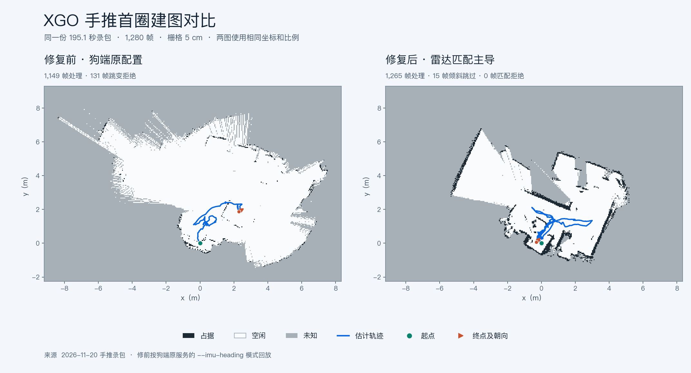

# XGO 机器狗 2D 建图使用手册

## 1. 打开实时建图

电脑和机器狗连接同一网络。机器狗当前地址为 `172.18.12.148`，IP 变化时以狗屏幕显示为准。

- [实时建图页面](http://172.18.12.148:8010)显示占据地图、轨迹、实时雷达和 IMU 姿态。白色是已观测的空闲空间，黑色是障碍物，灰色是未知区域，蓝线是估计轨迹，红色标记是当前位姿。
- [传感器状态](http://172.18.12.148:8000/stats)可检查雷达帧号和点数。[建图状态](http://172.18.12.148:8010/stats)可检查建图帧数和拒绝计数。

开新图后，先让狗在平地静止几秒，确认页上的建图帧数持续增长、雷达约 10 Hz。再沿路线匀速手推，慢转弯，尽量让连续扫描都看得到同一面墙或墙角。地图栅格为 5 cm，建图以雷达所在平面的观测为准。

要保存当前网页上的地图，在电脑终端运行：

```bash
curl -fS http://172.18.12.148:8010/map.png -o xgo-map.png
```

## 2. 从头启动或重开一张图

如果两个网页都能打开，可以直接使用。重开地图只需重启建图进程。采集服务在启动前应确认 `/dev/ttyUSB0` 已释放。

首次部署或更新脚本时，先从仓库根目录按 [README 的部署命令](../README.md#部署建图脚本)复制文件。在第一个 SSH 终端启动采集，专用建图配置会启用 IMU 并关闭相机：

```bash
ssh luwu@172.18.12.148
cd /home/pi
fuser -v /dev/ttyUSB0
# 没有占用者时启动采集
LUWU_ENABLE_IMU=1 LUWU_ENABLE_CAM=0 python3 -u webview.py
```

看到雷达已就绪后，从第二个 SSH 终端启动建图：

```bash
ssh luwu@172.18.12.148
cd /home/pi/tools
python3 -u slam2d.py --host 127.0.0.1 --port 8000 \
  --bind 0.0.0.0 --view-port 8010 --map-out /home/pi/tools/xgo-map.png
```

回到 [实时建图页面](http://172.18.12.148:8010)。两个前台命令各自用 `Ctrl+C` 停止。建图进程正常退出时会保存 PNG。若需在 Mac 上运行建图，可在仓库根目录执行 `python3 src/slam/slam2d.py --host 172.18.12.148`，然后打开 [本机建图页面](http://127.0.0.1:8010)。狗端采集仍需运行。

本次部署的后台进程把 PID 和日志放在 `/home/pi/.local/state/xgo-slam/`。重开图前先保存地图，核对 `slam.pid` 中的 PID 确实对应 `slam2d.py`，再向该 PID 发 `SIGTERM`。重启采集时同样核对 `webview.pid`，结束采集后用 `fuser -v /dev/ttyUSB0` 确认串口已释放。

## 3. 录包并离线回放

采集服务正常后，可在狗端独立录包。把录制时长改为覆盖整段路线，起点和终点各留几秒静止：

```bash
cd /home/pi/tools
python3 record_bag.py --seconds 120 -o walk-01.jsonl
```

在电脑的仓库根目录下载并回放：

```bash
mkdir -p data/bags
scp luwu@172.18.12.148:/home/pi/tools/walk-01.jsonl data/bags/
python3 src/slam/slam2d.py --replay data/bags/walk-01.jsonl \
  --no-view --map-out walk-01-map.png
```

首次试跑可以直接回放仓库里的 [手推首圈录包](../data/bags/2026-11-20_1302_手推首圈.jsonl)：

```bash
python3 src/slam/slam2d.py --replay data/bags/2026-11-20_1302_手推首圈.jsonl \
  --no-view --map-out /tmp/xgo-map.png
```

离线运行需要 Python 的 `numpy`、`scipy`、`Pillow` 和 `requests`，打开网页时还需要 `flask`。

`record_bag.py` 分别保存雷达帧和 IMU 样本，适合排查问题及重复回放。`slam2d.py --record FILE` 则保存建图程序消费到的帧。日常运行采用默认航向模式，由雷达匹配校正航向。做 IMU 对照实验时，用相同录包再跑一次 `--no-imu`，并给 `--map-out` 指定不同文件名。`--imu-heading` 是诊断选项，会把航向完全交给 IMU。

## 4. 常见问题

| 现象 | 检查方法 |
|---|---|
| `:8010` 打不开 | 先查 `:8000/stats`，再查建图进程和 `slam.log`。检查电脑与狗端网络及当前 IP。 |
| 雷达帧号停滞或日志反复出现 `Check Sum` | 用 `fuser -v /dev/ttyUSB0` 核对串口占用。确保只有一个雷达采集进程；重启采集后也重启建图，让建图从新的帧号开始。 |
| IMU 面板空白 | 检查采集服务是否带 `LUWU_ENABLE_IMU=1`。可访问 `:8010/live.json` 查看 `imu` 字段。 |
| 雷达有数据，但地图停止更新 | 看 `:8010/stats` 的 `skipped` 与 `rejected`。前者是 roll 或 pitch 超过 25°，后者是低置信度匹配或位姿跳变。把狗放平并减慢转向，必要时在有墙角的区域重开图。 |
| 回放的地图左右镜像 | 新录包已统一为车头 0°、左转为正。以 2026-11-20 12:46 前的旧坐标约定录制的包，需要先把极坐标角度取反，或将已转换的 XY 点的 Y 取反。 |

## 5. 对照样例

195.1 秒手推录包含 1,280 帧。修复版在狗端处理了 1,265 帧，因倾斜跳过 15 帧，匹配拒绝 0 帧。实机静止采集约 10 Hz。自主步态下的建图精度还需单独实测。


