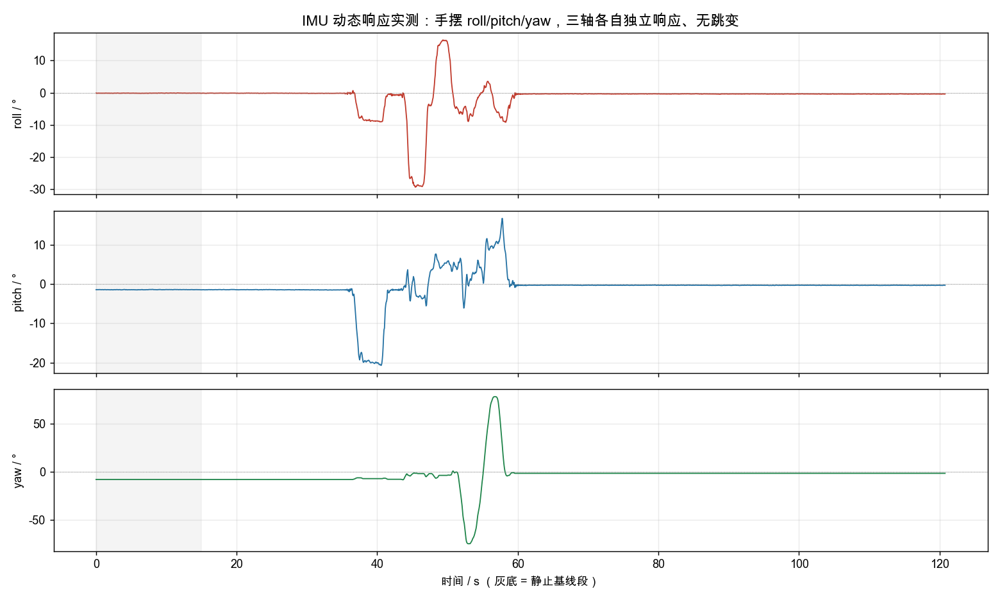
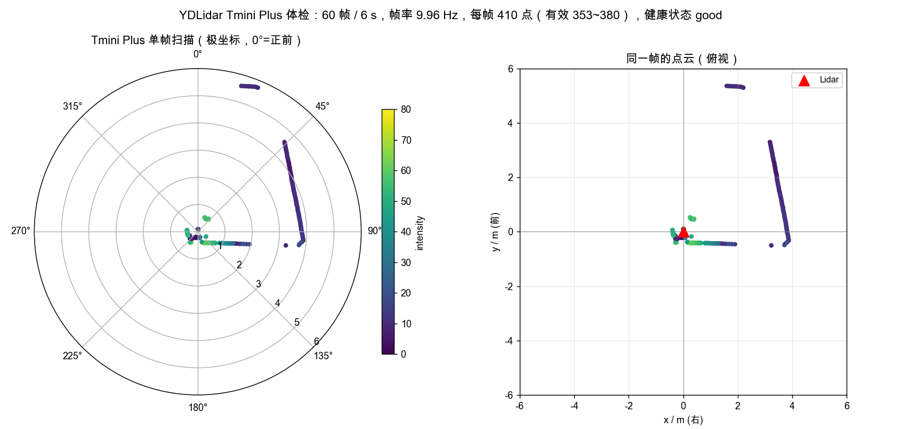

# 机器狗硬件体检报告（2026-11-20）

## 结论速览

| 部件 | 结论 | 一句话 |
|---|---|---|
| IMU（姿态角） | ✅ **可用** | roll/pitch 噪声 0.02°、三轴都能跟手响应；但 yaw 有固件死区，原始 9 轴包是坏的 |
| 激光雷达 | ✅ **正常** | YDLidar Tmini Plus，10 Hz 稳定、410 点/帧、360° 全覆盖、SDK 自检 good |
| 电池 | ⚠️ **7%** | 必须先充电，否则随时可能自动关机 |

## 被测设备

| 项 | 值 |
|---|---|
| 型号 | XGO-MINI（15 自由度，带机械臂） |
| 主控 | Raspberry Pi Compute Module 5 Lite Rev 1.0，Debian 13，kernel 6.12.75+rpt-rpi-2712 |
| 地址 / 账号 | `172.18.12.148`（主机名 `raspberrypi`），用户 `luwu` |
| 固件 | `M-7.0.0b8` |
| 电池 | 7%（测量时） |
| 测试时间 | 2026-11-20 10:57–11:06 |

---

## 一、IMU

### 1. 静止基线（30 s，16 Hz，纯读串口不动电机）

| 轴 | 均值 | 标准差 | 峰峰值 | 不同取值 |
|---|---|---|---|---|
| roll | −0.114° | 0.022° | 0.140° | 15 |
| pitch | −1.428° | 0.021° | 0.110° | 12 |
| yaw | −7.93° | **0.000°** | 0.000° | **1** |

- roll / pitch 表现正常：噪声 0.02° 量级，没有跳变、没有零漂。
- yaw 在 30 秒里**一个数都没变**——不是“零漂完美”，而是固件在静止时根本不更新 yaw（见下文限制）。

### 2. 动态响应（手摆测试，约 2 分钟，16 Hz）



| 轴 | 变化范围 | 最大角速度 | 单采样跳变 >10° | 丢帧 |
|---|---|---|---|---|
| roll | −29.3° ~ +16.3° | 66.5 °/s | 0 次 | 0 |
| pitch | −20.7° ~ +16.7° | 49.0 °/s | 0 次 | 0 |
| yaw | −74.6° ~ +78.0° | 97.4 °/s | 0 次 | 0 |

- 三轴各自独立、平滑地跟着手的动作走，说明 **IMU 芯片、姿态解算、串口链路都是活的**。
- 采样间隔稳定 62 ms（16 Hz），全程无 >0.15 s 的空洞。
- 手摆结束后回到静止，roll/pitch 恢复 0.02° 噪声水平。

### 3. 已知限制（不是这次才坏，是固件行为）

1. **`read_imu()` 返回死数据。** 它读的 0x65 寄存器没有正确填充，抓到的原始帧里混进了固件版本字符串 `0.0b8`，解码会得到 2.99e36 这类垃圾值。`src/robot/gait/onnx_runner.py` 的注释里也记录过 M-6.0.2 上同样的问题。**判断 IMU 好坏请以 `read_roll/pitch/yaw` 为准**；需要角速度就用姿态角差分 + 低通。
2. **yaw 有死区。** 静止时完全不更新，转向后可能有几度残差（本次手摆往返后残差约 6°，手摆误差无法严格区分），不能用于精细角度测量，用于“转 90°”这类粗动作没问题。

---

## 二、激光雷达

### 1. 自检结果

SDK 初始化日志：

```
Lidar successfully connected [/dev/ttyUSB0:230400]
Lidar running correctly! The health status good
Model: Tmini Plus    Firmware: 1.2    Hardware: 1
Serial: 2026022800090490
Scan Frequency: 10.00Hz    Fixed Size: 410    Sample Rate: 4.00K
```

### 2. 运行指标（6 s 连续扫描）

| 指标 | 实测 | 说明 |
|---|---|---|
| 帧率 | **9.96 Hz**（60 帧 / 6.0 s） | 稳定，失败 0 次 |
| 每帧点数 | 410（恒定） | 与 `Fixed Size: 410` 一致 |
| 有效点 | 353 ~ 380 / 帧 | 其余是超量程/无效返回 |
| 角度范围 | −180° ~ +180°，步进 0.88° | 360° 全覆盖 |
| 测距范围 | 0.08 ~ 6.25 m | 量程 0.05 ~ 16 m，本场景最远约 6 m |
| 强度 | 1 ~ 62（8 bit） | 有梯度，是真实反射面而不是死值 |
| 启动 | 初始化 1.24 s，扫描启动 2.10 s，首帧 0.05 s | 正常 |

### 3. 扫描点云



- 点云里能清楚看到前方约 5.5 m 的物体、右侧约 3.4 m 的墙面，几何关系合理。
- 正前方 0.08–0.2 m 有 23 个点：这是**雷达装在狗头上被自己的机身/机械臂挡住的自遮挡回波**，属正常现象，不是故障。
- 大量方向没有回波，说明测试时狗处在一个比较空旷的位置（6 m 内没有遮挡），不是雷达丢点。

> 如需验证**测距绝对精度**，可做一次已知距离对比：把一块纸板放在正前方 1.00 m，读回 ±2 cm 内即合格。

---

## 三、建议

1. **先充电**：7% 电量下不要让它自己走，容易走到一半掉电趴下。
2. IMU/雷达都可以正常用于课程项目；如果项目要做“精确转向角”，改用外部参照（视觉标记/激光匹配），不要依赖 yaw 的绝对值。
3. 原始 9 轴数据缺失对现有代码没有影响（`onnx_runner.py` 已经绕开），但不要再写依赖 `read_imu()` 的新代码。
4. 复测前先确认狗端的 IMU 与雷达串口均已释放。

```bash
scp src/diagnostics/imu_check.py luwu@172.18.12.148:/home/pi/tools/
scp src/robot/lidar.py luwu@172.18.12.148:/home/pi/
ssh luwu@172.18.12.148 'cd /home/pi/tools && python3 imu_check.py static --seconds 30'
ssh luwu@172.18.12.148 'cd /home/pi/tools && python3 /home/pi/lidar.py --seconds 6'
```

原始数据：[imu_move.csv](../../data/diagnostics/imu_move.csv)（手摆全过程）、[lidar_test.json](../../data/diagnostics/lidar_test.json)（60 帧统计 + 整帧点云）。
